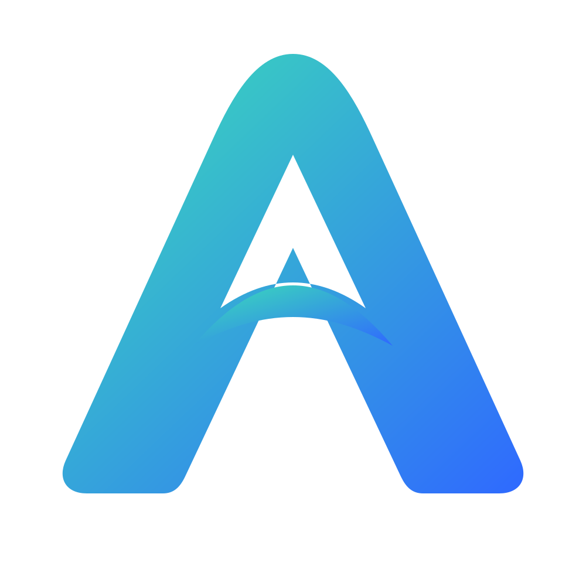
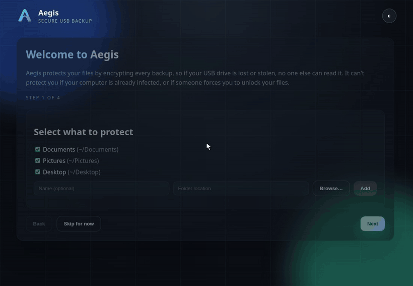

# Aegis

[](https://github.com/stcksmsh/aegis/actions/workflows/ci.yml)
[](https://github.com/stcksmsh/aegis/releases/latest)

[](#for-developers)

**Encrypted backups to a USB drive. Plug in → backed up.**

Aegis copies your important folders to a USB drive and locks them with a passphrase only you know. If your laptop dies, gets stolen, or gets hit by ransomware, plug the drive into any computer and get your files back. If someone steals the drive, they get nothing.



## Download

Get the installer for your computer from the **[latest release](https://github.com/stcksmsh/aegis/releases/latest)**:

| Computer | File to download |
|---|---|
| Windows 10 / 11 | `Aegis_…_x64-setup.exe` |
| Mac with Apple chip (M1 and newer) | `Aegis_…_aarch64.dmg` |
| Mac with Intel chip | `Aegis_…_x64.dmg` |
| Ubuntu / Debian / Mint | `Aegis_…_amd64.deb` |
| Fedora / openSUSE | `Aegis-…x86_64.rpm` |
| Other Linux | `Aegis_…_amd64.AppImage` |

Everything Aegis needs is inside the installer. Nothing else to set up.

Aegis is free and not signed with a paid Apple/Microsoft certificate, so the first launch shows a warning. It's safe to continue:
**Windows**: "More info" → "Run anyway". **Mac**: open Aegis once, click "Done", then System Settings → Privacy & Security → scroll down → "Open Anyway". [Details](docs/USER_GUIDE.md#first-launch-warning)

## How it works

1. **Pick folders** — Documents, Pictures, Desktop, or anything else.
2. **Pick a passphrase** — write it down. No one (not even Aegis) can recover it.
3. **Plug in a USB drive** — Aegis sets it up without deleting what's already on it.
4. **Done.** Next time you plug the drive in, Aegis backs up by itself. Only changed files are copied, so later backups are fast.

Restore: open Aegis → **Restore** → pick a date → pick a folder. New computer? Install Aegis, plug in the drive, type your passphrase.

Full walkthrough: **[User Guide](docs/USER_GUIDE.md)** · all docs: **[docs/](docs/README.md)**.

## What you get

| Feature | |
|---|---|
| Strong encryption | Every backup is encrypted (AES-256) before it touches the drive. |
| Automatic | Backs up when you plug in your drive. Runs quietly in the tray / menu bar. |
| History | Get back last week's file. Old backups are thinned out automatically (one per day for a week, per week for a month, per month for a year), so the drive doesn't fill up. |
| Get back one file | Browse any past backup and restore just the files you need. Never overwrites what's already there. |
| Reminders | Nudges you when it's been a week since your last backup. Optional hourly backups while the drive stays plugged in. |
| Drive space | Shows free space and warns before your drive fills up. |
| Restore without Aegis | Every drive carries an AEGIS-RESTORE folder with step-by-step instructions, so anyone can get the files back on any computer, even without Aegis installed. |
| Several backups, one drive | Share one drive between computers or people, each backup with its own passphrase. Moving to a new computer? Type the passphrase there and carry on. |
| Safe to unplug | Unplugging mid-backup never damages earlier backups. |
| Checks itself | Verifies each backup after it finishes. |
| No lock-in | Backups use the open [restic](https://restic.net) format. Readable without Aegis. |
| Private | No accounts, no cloud. Your files never leave your computer and your drive. The only internet use is checking for Aegis updates. Your passphrase is never saved to disk (optionally kept in your system keychain). |
| Updates itself | Fixes install by themselves, never during a backup. Updates are signed, so only genuine Aegis updates are accepted. |
| Your language | English and Serbian (Cyrillic and Latin). [Help translate](docs/TRANSLATING.md). |
| Windows, macOS, Linux | Same app everywhere. A drive made on one works on the others (use exFAT). |

## For developers

```bash
bash scripts/fetch-restic.sh x86_64-unknown-linux-gnu   # bundled restic (your target triple)
bash scripts/fetch-restore-kit.sh                         # restore kit copied onto drives
cargo run -p aegis-ui                                    # desktop app with embedded agent
```

- [CONTRIBUTING.md](CONTRIBUTING.md) — setup, checks, release process
- [CLAUDE.md](CLAUDE.md) — project layout and rules
- [docs/ipc.md](docs/ipc.md) — local API
- [docs/AGENT_SERVICE.md](docs/AGENT_SERVICE.md) — run the agent headless as a service (optional)
- [CHANGELOG.md](CHANGELOG.md)
- [SECURITY.md](SECURITY.md) — how Aegis protects your data; reporting vulnerabilities

Rust + [Tauri](https://tauri.app), backups by [restic](https://restic.net). License: [MIT](LICENSE-MIT) OR [Apache-2.0](LICENSE-APACHE).
