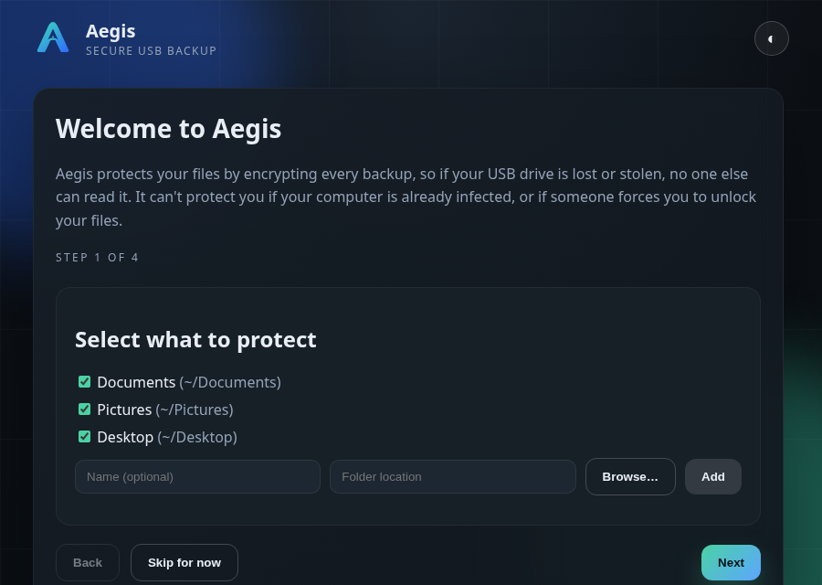
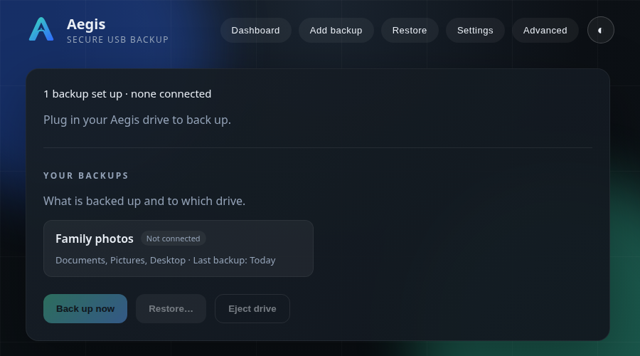

# Aegis User Guide

Aegis backs up your folders to a USB drive. Backups are encrypted with a passphrase only you know. Plug the drive in → Aegis backs up. Lose your computer → plug the drive into a new one and get your files back.

## 1. Install

Go to the [latest release](https://github.com/stcksmsh/aegis/releases/latest) and download the file for your computer:

| Your computer | Download | Then |
|---|---|---|
| Windows | `Aegis_x.y.z_x64-setup.exe` | Double-click. If Windows says "Windows protected your PC": click **More info → Run anyway**. |
| Mac (Apple chip, 2020+) | `Aegis_x.y.z_aarch64.dmg` | Open, drag Aegis to Applications. First launch: see [below](#first-launch-warning). |
| Mac (Intel) | `Aegis_x.y.z_x64.dmg` | Same as above. |
| Linux (Ubuntu, Debian, Mint) | `Aegis_x.y.z_amd64.deb` | Double-click to install, or `sudo apt install ./Aegis_*.deb`. |
| Linux (any other) | `Aegis_x.y.z_amd64.AppImage` | Right-click → Properties → allow executing, then double-click. |

Not sure which Mac you have? Apple menu → **About This Mac**. "Chip: Apple M…" = Apple chip. "Processor: Intel" = Intel.

### First-launch warning

Aegis is free and isn't signed with a paid Apple or Microsoft certificate, so your computer warns you the first time. This happens once.

- **Windows** — "Windows protected your PC": click **More info**, then **Run anyway**.
- **Mac** — "Aegis can't be opened" / "Apple could not verify…":
  1. Click **Done** (not "Move to Trash").
  2. Open **System Settings → Privacy & Security**, scroll down, click **Open Anyway** next to Aegis, and confirm with your password.
  3. On older macOS (14 and earlier) you can instead right-click Aegis in Applications → **Open** → **Open**.

Nothing else to install. Aegis includes everything it needs.

**Mac:** the first time Aegis backs up, macOS asks whether Aegis may access your Documents, Desktop, or removable drives. Click **Allow**, or those folders can't be backed up. Changed your mind? System Settings → Privacy & Security → Files and Folders → Aegis.

## 2. First setup (about 2 minutes)

1. Open Aegis. The welcome wizard starts.
2. **Pick folders** to protect (Documents, Pictures, Desktop, or your own). For your own: click **Browse…** to choose the folder (or type its location), give it a name if you like, then click **Add**. Click ✎ on an added folder to rename it, × to remove it.
3. **Choose a passphrase.** Write it down on paper and keep it somewhere safe.
   > ⚠️ Without the passphrase, nobody can open your backups — not even you. There is no reset.

   Then choose **Remember my passphrase on this computer** (needed for automatic backups) or **Ask for my passphrase every time**. You can change this later in **Settings**.
4. **Plug in a USB drive** and pick it. You can give the backup a **Name** (optional). You can use a drive that already has files; Aegis stores backups in a hidden `.aegis` folder and does not touch your other files. Erasing the drive is optional: only if you want it wiped first, tick **Erase this drive** and type ERASE. If the drive shows up but can't be used yet, click **Open drive**.
5. Click **Run first backup now** (or **Skip for now**). The first backup takes longest; later ones only copy what changed. How fast it goes depends mostly on the drive: a cheap USB stick writes about 10 MB per second (roughly 25 minutes for 15 GB), a USB SSD ten times faster.

## 3. Everyday use

- **Plug in your drive → backup starts automatically** (if Aegis remembers your passphrase and **Start Aegis when I log in** is on). Otherwise open Aegis and click **Back up now** (**Back up all** if the drive holds several backups).
- Each backup has its own card under **Your backups**, with **Back up now**, **Restore…** and its own progress bar.
- The tray / menu bar icon shows the plugged-in drive (for example "DataTraveler 3.0 (57.8 GB)") with its backups: **Back up "name"** for each, **Back up all** when there are several, and **Eject** (ejects right away; a notification says when it's safe to unplug). Plus **Open Aegis** and **Quit Aegis**.
- The ◐ button in the top right switches the look: match your computer, light, or dark.
- The dashboard shows how the last backup went, for example "Last backup finished today at 14:02. Everything was saved." If it didn't finish, the same line says why and what to do.
- Closing the window keeps Aegis running in the tray / menu bar so it can notice your drive. To stop it fully: tray icon → **Quit Aegis**.
- Wait until the backup is done, then click **Eject drive** before unplugging.
- Click a card's name to see more: **Rename** changes the name Aegis shows for that backup (the drive itself isn't renamed), **Edit folders** changes what is backed up (adding a folder starts a backup right away), **Delete from drive** is explained in [section 4](#several-backups-on-one-drive), **Forget on this computer** in [section 6](#6-moving-backups-to-another-computer).
- When an update is ready, a bar at the top offers **Install and restart**. Aegis never updates in the middle of a backup or restore.
- Unplugged mid-backup? No harm. Older backups stay intact; the next backup picks up again.

## 4. Get files back

1. Plug in the drive, open Aegis, go to **Restore**.
2. Click **Show backups** (each backup is listed with its date).
3. Pick one and choose an empty folder: type it, or click **Browse…**.
4. Click **Restore everything** for the whole backup, or click **Restore selected**.

Aegis restores into the folder you choose; it never overwrites your current files. Changed your mind? Click **Stop restore**; the files restored so far stay in that folder.

Deleted a file, or removed a folder from Aegis? Older backups still have it, so you can get it back for up to a year. After that, Aegis cleans it off the drive (see **Clean up old backups** in [section 7](#7-settings-explained)).

### Getting back just some files

If you only lost a few files or one folder, you don't need to restore everything:

1. After picking a backup, a list of its folders appears below it.
2. Click the arrow next to a folder to look inside it.
3. Check the boxes next to the files or folders you want back.
4. Choose an empty folder, then click **Restore selected**.

### On a new or reinstalled computer

Install Aegis, plug in the drive, choose **Add backup**, pick the drive and type your **original passphrase**. Aegis finds the backup that this passphrase opens. Then use **Restore**.

### Several backups on one drive

One drive can hold separate backups, for example one per company. Each has its own passphrase, and each passphrase opens only its own backup.

To add another one, choose **Add backup** on a drive that already has backups and type a **new** passphrase. Aegis asks before it creates a separate backup, so a mistyped passphrase never starts a new one by accident. Each backup needs its own passphrase: typing the passphrase of a backup you already have adds the folders you chose to that backup (Aegis tells you), it doesn't make a new one. Each backup gets its own card on the dashboard; **Restore…** on a card opens the Restore page for that backup (or pick it under **Backup on this drive** there).

Backups on the same drive run one after another (a card says **Waiting** until its turn): a USB drive isn't faster with two at once. You can restore from one backup while another one is backing up.

No longer need one of them? Plug in the drive, click the card's name, and choose **Delete from drive**, then type its name. That backup and all its saved versions are deleted from the drive; the other backups stay. Erasing the whole drive also removes all its backups from Aegis.

## 5. Restoring without Aegis

After each backup, Aegis keeps a folder called **AEGIS-RESTORE** on the drive up to date. It lets you get your files back on any Windows, Mac or Linux computer, even one without Aegis:

1. Open **AEGIS-RESTORE** on the drive and read **README.txt** (English). If Aegis is set to Serbian, the same steps are also in **PROCITAJ.txt**.
2. Double-click **restore-windows.bat** (Windows) or **restore-mac.command** (Mac). On Linux, run `bash restore-linux.sh`.
3. Type your passphrase and press Enter twice.

Your files go into a new folder on the Desktop called "Aegis restore" followed by the date. Nothing on the computer is overwritten.

**Advanced → Save drive details** also saves a short note about where your backup is on the drive, to keep with your papers. It contains no passphrase.

Aegis stores backups in the open [restic](https://restic.net) format, so a technical helper can also restore them with your passphrase.

## 6. Moving backups to another computer

A backup belongs to the data, not to a computer. To let another computer take over (for example, you set it up on your laptop and the office PC should continue):

1. On the new computer: install Aegis, plug in the drive, choose **Add backup**, pick the drive and type the backup's passphrase.
2. Aegis finds the existing backup and shows which folders the other computer backed up. If the files live in different folders on this computer, open the drive under **Your backups** and choose **Edit folders**.
3. Earlier backups stay on the drive and can still be restored. On the Restore page, each backup shows which computer made it. Cleaning up old backups on one computer never deletes the other computer's backups.
4. On the old computer: open the drive under **Your backups** and choose **Forget on this computer**. Aegis stops backing up there and forgets the saved passphrase; the backups on the drive are kept. Delete any copies of the files that should not stay on the old computer. **Forget** also works for a drive that is lost or broken: the drive doesn't need to be plugged in.

### Passphrase sheet

When a new backup is set up, Aegis offers to **Print passphrase sheet**. It shows a page inside Aegis; click **Print…** to print it (or save it as a PDF): the backup's name, a blank to write the passphrase on by hand, and how to get your files back, in the language Aegis is set to. Keep it in a safe place, never together with the drive.

## 7. Settings explained

Each page has its own Save button and saves only what is on that page.

**Settings**

| Setting | Meaning |
|---|---|
| Language | English, Serbian Cyrillic (Српски) or Serbian Latin (Srpski). "Same as this computer" follows your computer's language. Changes right away. If you picked a language you can't read, it's the first box under **Settings**, labelled "(Language)". |
| Skip these files or folders | Files to skip, e.g. `*.tmp` or `node_modules`. Aegis already skips temporary files and Windows/Mac system clutter. |
| Quickly check each backup after it's made | After each backup, quickly checks that it can be read. Recommended. |
| Delete the oldest backups when the drive is full | On by default. Before each backup, if less than 10% of the drive is free, Aegis deletes this computer's oldest backups one at a time until there is room again. The 3 newest backups are always kept. A message tells you which backups were removed. |
| Back up automatically when your Aegis drive is plugged in | Automatic backups on plug-in. Needs "Remember my passphrase on this computer". |
| Start Aegis when I log in | Aegis starts in the tray / menu bar when you log in, so it notices your drive. Needed for automatic backups. Takes effect right away. |
| Your passphrase: Remember my passphrase on this computer | Keeps the passphrase in your computer's secure storage so backups run without asking. |
| Your passphrase: Ask for my passphrase every time | Never keeps the passphrase; you type it every time. No automatic backups. |
| Remind me to back up after this many days | If your drive hasn't been backed up for this many days, Aegis reminds you. 0 = never. |
| Back up again every this many hours | If you leave the drive plugged in, Aegis backs up again every N hours. 0 = only when plugged in. |

**Advanced**

| Setting | Meaning |
|---|---|
| Check backups thoroughly | Reads back all backup data after each backup. Much slower; catches failing drives. |
| Only back up files like these | Leave empty to back up everything in your folders. Example: `*.docx, *.pdf`. |
| Clean up old backups | How many old backups to keep (newest, daily, weekly, monthly, yearly). On from the start: Aegis keeps a backup from each of the last 7 days, 4 weeks and 12 months, plus the 3 newest, and deletes older ones so the drive doesn't fill up. Untick **Automatically delete old backups based on these settings** to keep everything (the drive then fills up over time). |
| Save drive details | Saves a short note about where your backup is on the drive. No passphrase in it. |
| Open log files | Opens the folder with Aegis's logs, for when you ask for help. |

## 8. Problems?

| Problem | Fix |
|---|---|
| Drive not detected | Unplug and re-plug. Make sure the drive shows up in your file manager. |
| "Wrong passphrase" | Passphrases are case-sensitive. Check Caps Lock. |
| "Saved, but some files were skipped" | Some files were open or couldn't be read. Everything else was saved. Close other apps and back up again. |
| "Saved, but these folders weren't found" | A folder Aegis backs up was moved, renamed or deleted. Everything else was saved. Open the drive under **Your backups** and choose **Edit folders**. |
| Can't erase drive | Unplug it, plug it back in, and try again. Still failing? Erase it as **exFAT** with Disk Management (Windows) or Disk Utility (Mac), then try again. |
| "Your backup drive is almost full" | Less than 10% free space is left on the drive (with **Delete the oldest backups when the drive is full** on, Aegis already deleted what it could). Plug in a bigger drive, free up space on it, or keep fewer old backups in **Advanced → Clean up old backups** (make sure **Automatically delete old backups** is ticked). |
| Something else | Open an [issue](https://github.com/stcksmsh/aegis/issues) and attach the logs: **Advanced → Open log files**. They are in: Windows `%LOCALAPPDATA%\aegis\Aegis\data\logs`, Mac `~/Library/Application Support/com.aegis.Aegis/logs`, Linux `~/.local/share/aegis/logs`. Logs never contain your passphrase. |
